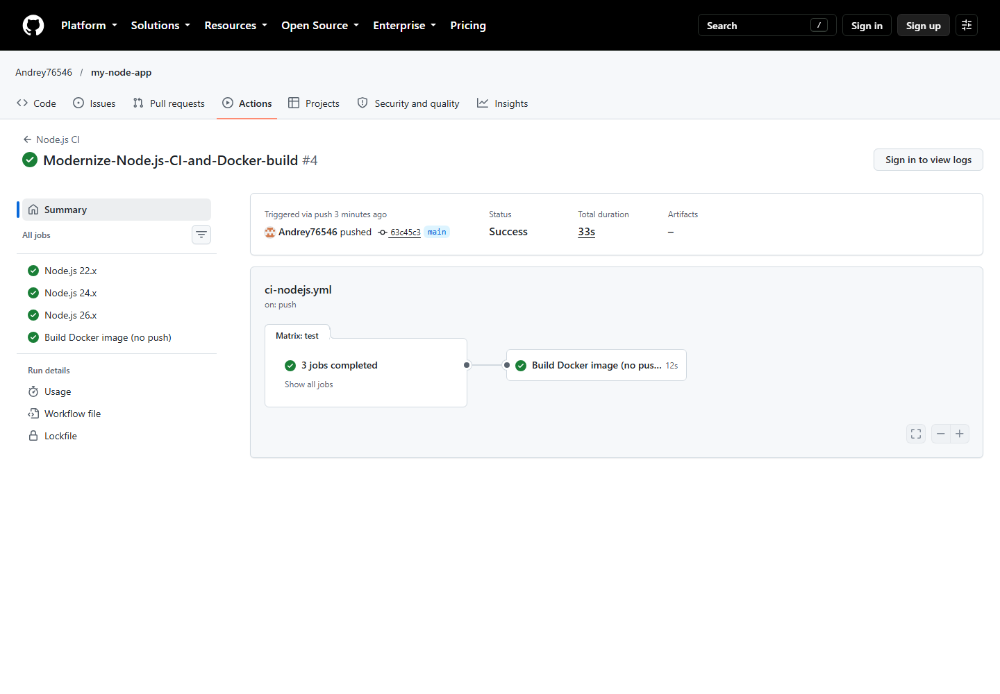

# Лабораторная работа 3. Node.js CI pipeline

## Цель работы

Настроить непрерывную интеграцию Node.js-приложения: ESLint, тесты Jest в нескольких поддерживаемых версиях Node.js и сборку Docker-образа без публикации.

## Что сделано

- Workflow [`ci-nodejs.yml`](.github/workflows/ci-nodejs.yml) запускается для `push`, `pull_request` и вручную.
- Матрица проверяет Node.js `22.x`, `24.x` и `26.x` на `ubuntu-24.04`.
- Для каждой версии выполняются воспроизводимая установка `npm ci`, ESLint и три теста Jest.
- После успешного завершения всей матрицы отдельная задача собирает Docker-образ.
- Docker job выполняется при любом поддерживаемом типе запуска и не пропускается из-за фильтра события.
- Минимальная версия проекта — Node.js 22, а Docker-образ основан на `node:24-alpine`.

## Как запускать / проверять

Локальная проверка:

```bash
npm ci
npm run lint
npm test
docker build -t my-node-app:test .
docker run --rm my-node-app:test
```

В GitHub откройте вкладку **Actions** и выберите **Node.js CI**. Успешный запуск должен содержать три зелёные задачи матрицы и зелёную задачу **Build Docker image (no push)**.

## Результат выполнения

[Node.js CI #4](https://github.com/Andrey76546/my-node-app/actions/runs/39559423610) завершён со статусом **Success**: Node.js `22.x`, `24.x`, `26.x`, ESLint, Jest и сборка Docker-образа прошли успешно (4 из 4 jobs).

## Скриншот



## Ссылка на workflow / Actions

- [Файл workflow](.github/workflows/ci-nodejs.yml)
- [Все запуски Node.js CI](https://github.com/Andrey76546/my-node-app/actions/workflows/ci-nodejs.yml)
- [Подтверждённый успешный запуск](https://github.com/Andrey76546/my-node-app/actions/runs/39559423610)
